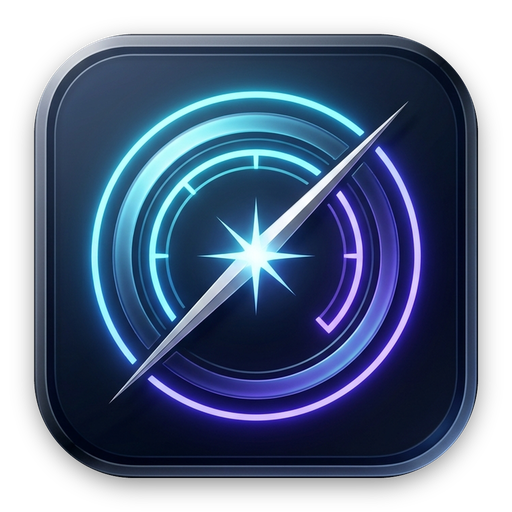
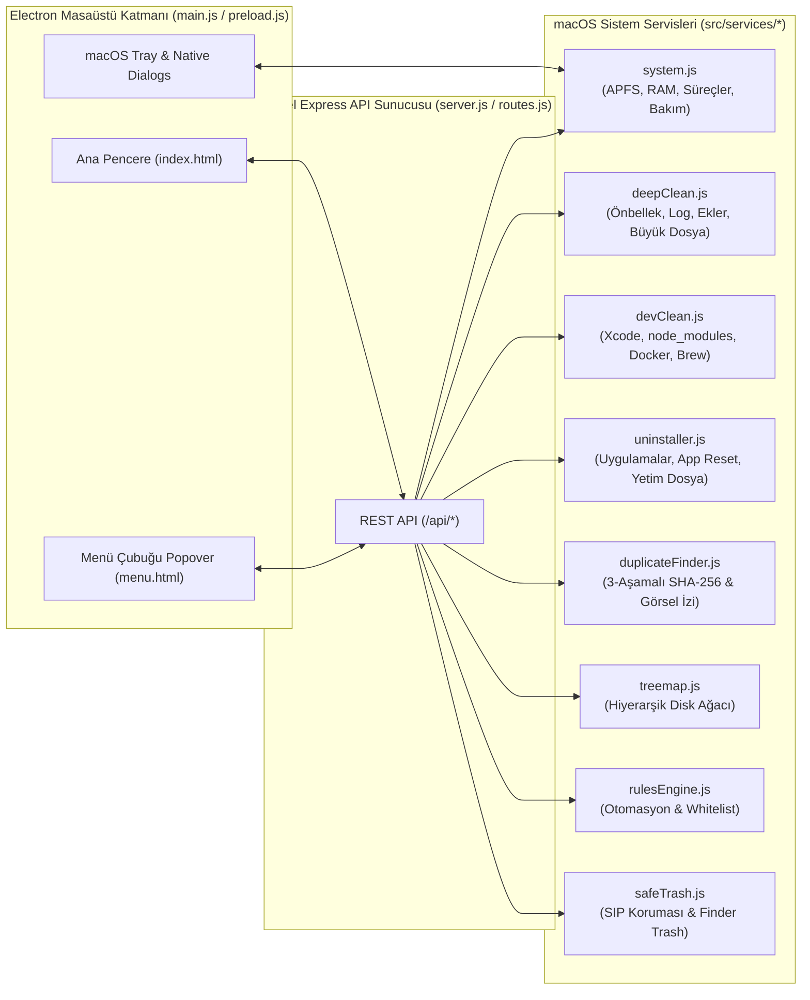

<div align="center">



# mac-cleaner

**Gelişmiş macOS Depolama Yöneticisi, Geliştirici Temizlik Aracı, Akıllı Kaldırıcı ve Canlı Menü Çubuğu Asistanı**  
*Advanced macOS Storage Manager, Developer Cache Cleaner, Smart Uninstaller & Live Menu Bar Companion*

[-000000?style=for-the-badge&logo=apple&logoColor=white)](https://github.com/imozkandev/Mac-Cleaner)
[%20%26%20Intel-38bdf8?style=for-the-badge&logo=apple&logoColor=white)](https://github.com/imozkandev/Mac-Cleaner)
[](https://www.electronjs.org/)
[](https://github.com/imozkandev/Mac-Cleaner)
[](LICENSE)

<br />

### 🌐 Dil Seçimi / Language Selection

[**🇹🇷 Türkçe Dokümantasyon**](#-türkçe-dokümantasyon) &nbsp;|&nbsp; [**🇬🇧 English Documentation**](#-english-documentation) &nbsp;|&nbsp; [**📄 Standalone English (`README.en.md`)**](README.en.md)

</div>

---

# 🇹🇷 Türkçe Dokümantasyon

## 🌟 Proje Hakkında

**`mac-cleaner`**, macOS'un yerleşik depolama yönetimi aracının (*Sistem Ayarları > Genel > Depolama*) "Sistem Verileri" (*System Data*) altında gizlediği yüzlerce gigabaytlık önbelleği, geliştirici kalıntılarını (`Xcode DerivedData`, `node_modules`, `.venv`, `Docker`, `Homebrew`), silinmiş uygulamaların unutulan artıklarını ve çift dosyaları şeffaf bir şekilde analiz edip güvenle temizlemek için tasarlanmış açık kaynaklı bir macOS masaüstü uygulamasıdır.

Tüm silme işlemleri varsayılan olarak **macOS Finder Çöp Kutusu (`~/.Trash`)** üzerinden gerçekleştirilir (**Safe Trash**) ve **macOS System Integrity Protection (SIP)** kurallarına %100 uyumludur.

---

## 🆚 macOS Dahili Depolama Aracı vs. `mac-cleaner`

| Özellik / Modül | macOS Dahili Depolama Aracı | `mac-cleaner` |
| :--- | :--- | :--- |
| **APFS Gerçek Disk Analizi** | "Sistem Verileri" altında belirsiz gruplama | ✅ APFS konteyner bazlı gerçek doluluk ve kategori kırılımı |
| **Geliştirici Temizliği (Xcode, Docker, Node, Python)** | Yok | ✅ `DerivedData`, Simülatörler, `.xcarchive`, `node_modules`, `.venv`, `target/`, Docker & Brew |
| **Kalıntısız Uygulama Kaldırma & Sıfırlama** | Sadece `.app` paketini siler (Library kalıntıları kalır) | ✅ 9 farklı `~/Library` dizininde kalıntı tespiti, Yetim Dosya Bulucu ve **App Reset** |
| **Canlı Süreç & RAM Yönetimi** | Yok (Etkinlik Monitörü ayrı açılır) | ✅ Canlı RAM/CPU süreç izleyici, süreç sonlandırma ve tek tıkla RAM Purge |
| **Başlangıç Servisleri & Sistem Bakımı** | Sadece temel liste | ✅ `LaunchAgents` başlat/durdur/sil ve DNS, QuickLook, Font, LaunchServices onarımı |
| **Çift & Benzer Dosya Bulucu** | Yok | ✅ 3-Aşamalı Hash (`Boyut -> 64KB MD5 -> Tam SHA-256`) + Algısal Benzer Fotoğraf Tespiti |
| **Görsel Disk Haritası (Treemap)** | Yalnızca yatay çubuk | ✅ Etkileşimli Canvas Treemap, sınırsız alt klasör delme (*drill-down*) ve Finder entegrasyonu |
| **Menü Çubuğu Asistanı (Menu Bar Companion)** | Yok | ✅ macOS üst menü çubuğunda canlı RAM/Disk yüzdesi ve Sürükle-Bırak güvenli silme |
| **Otomasyon & Akıllı Kural Motoru** | Yok | ✅ Özel kural oluşturma, klasör büyüme alarmları ve Dry-Run (Önizleme) desteği |
| **Dil ve Tema Desteği** | Sistem varsayılanı | ✅ Türkçe / İngilizce (`TR` / `EN`) anlık geçiş ve Koyu / Açık (`Dark` / `Light`) tema |

---

## ⚡ Temel Modüller ve Özellikler

### 1. 📊 Genel Bakış & Canlı Süreç İzleyici (Dashboard & Process Inspector)
- **APFS Doğruluklu Disk & RAM Göstergeleri:** macOS Catalina+ APFS Signed System Volume yapısıyla uyumlu gerçek konteyner kapasitesi, kullanılan alan ve boş alan hesaplaması.
- **Dinamik Depolama Dağılım Çubuğu:** Geliştirici önbellekleri, Uygulamalar, Medya, Belgeler/İndirilenler, Çöp Kutusu ve Boş Alan kategorilerinin gerçek boyutlarını canlı hesaplar.
- **Canlı Süreç İzleyici (Process Inspector):** Sistemde en çok RAM ve CPU tüketen süreçleri anlık listeler, sıralar ve yanıt vermeyen süreçleri uygulama içinden güvenle sonlandırır.

### 2. 🧹 Derin Sistem & Kullanıcı Temizliği (Deep System Clean)
- **Tarayıcı & Uygulama Önbellekleri:** Google Chrome, Safari, Brave, Arc, Edge, Firefox, Spotify, Discord, Slack, Telegram, Zoom, VS Code ve JetBrains önbelleklerini tespit eder.
- **Sistem & Uygulama Logları:** `~/Library/Logs` ve çökme raporlarını (`DiagnosticReports`) analiz eder.
- **Mesaj & Posta Ekleri:** `iMessage` ve `Apple Mail` yerel medya eklerini listeler.
- **İndirme Kalıntıları & Büyük Dosyalar:** Unutulmuş `.dmg`, `.pkg`, `.iso`, `.crdownload`, `.part` dosyalarını ve `>100 MB` ile `>5 GB` arasındaki büyük/eski dosyaları bulur.

### 3. 🛠️ Geliştirici & Güç Kullanıcısı Temizliği (Developer Clean)
- **Xcode Derin Temizlik:** `DerivedData`, `CoreSimulator` cihaz önbellekleri, `.xcarchive` paketleri ve çökme loglarını tek tek veya topluca temizler.
- **Proje Bağımlılık Denetçisi:** Varsayılan geliştirici klasörlerinde veya seçtiğiniz özel bir dizinde bulunan `node_modules`, `.venv`, `venv`, `target`, `vendor`, `.next`, `dist`, `build` klasörlerini tarar; **30 günden uzun süredir dokunulmayan** pasif projeleri işaretler.
- **Konteyner & Paket Yöneticileri:** `docker system df` / `docker system prune`, `brew cleanup` ve `npm`, `yarn`, `pnpm`, `pip`, `cargo`, `gradle` önbellek temizliği.

### 4. 📦 Akıllı Uygulama Kaldırıcı & Uygulama Sıfırlama (Smart Uninstaller & App Reset)
- **9 Dizinli Kalıntı Tespiti:** Uygulamaların `Application Support`, `Caches`, `Preferences`, `Saved Application State`, `LaunchAgents`, `Containers`, `Group Containers`, `HTTPStorages` ve `WebKit` dizinlerindeki tüm izlerini bulur.
- **Uygulama Sıfırlama (App Reset):** Uygulamanın kendisini (`.app`) silmeden yalnızca seçtiğiniz önbellek ve ayar kalıntılarını temizleyerek uygulamayı ilk kurulduğu haline sıfırlar.
- **Yetim Kalıntı (Orphaned Files) Bulucu:** Daha önce Finder üzerinden silinmiş ancak `~/Library` altında klasörleri kalmış eski uygulama artıklarını tespit eder.

### 5. 🔧 Sistem Bakımı & Başlangıç Servisleri (Maintenance & LaunchAgents)
- **macOS Bakım Araçları:**
  - **DNS Önbelleği Sıfırlama:** `dscacheutil -flushcache` ve `mDNSResponder` yenilemesi.
  - **QuickLook Önbelleği Sıfırlama:** `qlmanage -r cache` ile bozuk küçük resimleri onarma.
  - **Font Önbelleği Temizleme:** `atsutil databases -removeUser` ile kullanıcı yazı tipi veritabanını yenileme.
  - **LaunchServices Onarımı:** Finder *"Birlikte Aç"* menüsündeki mükerrer/silinmiş uygulama kayıtlarını yeniden indeksleme.
- **LaunchAgents & Daemons Yöneticisi:** `~/Library/LaunchAgents`, `/Library/LaunchAgents` ve `/Library/LaunchDaemons` altındaki `.plist` servislerini listeler, çalışma durumunu gösterir ve kullanıcı servislerini başlatıp durdurabilir veya silebilir.

### 6. 🔍 Çift & Benzer Dosya Analizörü (Duplicate & Similar Photo Finder)
- **3-Aşamalı Hızlı Hash Algoritması:**
  1. Dosya boyutuna göre ön gruplama,
  2. İlk `64 KB` üzerinden hızlı `MD5` kısmi hash kontrolü,
  3. Adaylar üzerinde tam `SHA-256` doğrulaması (%100 kesinlik).
- **Algısal Benzer Fotoğraf Gruplama:** Benzer görselleri ve seri çekimleri tespit eder.
- **Akıllı Seçim (Smart Select):** *Orijinali Koru*, *En Yeniyi Koru* veya *En Eskiyi Koru* kurallarıyla tek tıkla seçim.

### 7. 🗺️ Etkileşimli Disk Haritası (Interactive Treemap Visualizer)
- HTML5 Canvas tabanlı orantısal blok görselleştirmesi.
- Klasörlere tıklayarak sınırsız alt dizine inme (*deep drill-down*), *breadcrumb* gezinme çubuğu, özel klasör seçimi ve seçili öğeyi Finder'da açma veya Çöp Kutusu'na taşıma.

### 8. 🖥️ Canlı Menü Çubuğu Asistanı (Menu Bar Companion) & Otomasyon Kuralları
- **macOS Tray & Popover:** Ana pencere kapalıyken bile üst menü çubuğunda canlı RAM yüzdesi gösterir; tıklandığında açılan yerel *vibrancy popover* penceresinden RAM boşaltma, Çöp Kutusu boşaltma ve **Sürükle-Bırak (Drag & Drop)** dosya silme imkanı sunar.
- **Akıllı Kural Motoru:** Özel temizlik kuralları tanımlama (hedef klasör, uzantı listesi, gün sınırı), klasör büyüme alarmları, *Dry-Run* önizleme ve **Kullanıcı İstisna Listesi (Whitelist)**.

---

## 🏗️ Sistem Mimarisi & Dizin Yapısı



```text
mac-cleaner/
├── assets/                  # Uygulama ikonları (icon.icns, icon.png, logo.png, logo.svg, trayTemplate.png)
├── main.js                  # Electron ana süreç, macOS Frameless pencere ve Menu Bar Tray yönetimi
├── preload.js               # Güvenli ContextBridge IPC köprüsü (Finder, Klasör Seçici, Pencere kontrolü)
├── server.js                # Gömülü yerel Express API ve statik dosya sunucusu
├── package.json             # Proje bağımlılıkları ve electron-builder paketleme yapılandırması
└── src/
    ├── api/
    │   └── routes.js        # Tüm modüller için REST API uç noktaları (/api/*)
    ├── services/
    │   ├── system.js        # RAM, APFS Disk, Depolama Kırılımı, Süreçler, LaunchAgents ve Bakım
    │   ├── deepClean.js     # Tarayıcı/Uygulama önbellekleri, loglar, ekler ve büyük dosyalar
    │   ├── devClean.js      # Xcode, proje bağımlılıkları (node_modules/.venv), Docker & Homebrew
    │   ├── uninstaller.js   # Uygulama tarayıcı, 9 dizinli kalıntı bulucu, App Reset ve yetim dosyalar
    │   ├── duplicateFinder.js # Boyut + 64KB MD5 + SHA-256 çift dosya ve benzer görsel motoru
    │   ├── treemap.js       # Etkileşimli Disk Haritası veri ağacı oluşturucu
    │   ├── rulesEngine.js   # Otomasyon kuralları ve Whitelist kalıcı yönetimi (~/.config/mac-cleaner)
    │   └── safeTrash.js     # SIP yol koruması ve Finder AppleScript tabanlı güvenli Çöp Kutusu katmanı
    └── public/
        ├── index.html       # Ana uygulama arayüzü (Dark/Light tema, TR/EN lokalizasyon)
        ├── menu.html        # macOS Menü Çubuğu Popover arayüzü
        ├── css/             # Modern glassmorphic stil dosyaları (main.css, components.css, treemap.css)
        └── js/              # Modüler frontend kontrolcüleri (app, deepClean, devClean, uninstaller, vb.)
```

---

## 🚀 Kurulum, Çalıştırma ve Derleme

### Gereksinimler
- **İşletim Sistemi:** macOS 12.0 (Monterey) veya üzeri (Apple Silicon `M1/M2/M3/M4` ve Intel destekli)
- **Node.js:** `v18.0.0` veya üzeri

### 1. Projeyi Klonlayın ve Bağımlılıkları Yükleyin
```bash
git clone https://github.com/imozkandev/Mac-Cleaner.git
cd Mac-Cleaner
npm install
```

### 2. Masaüstü Uygulamasını Çalıştırın (Electron + Menü Çubuğu)
```bash
npm start
```

### 3. Sadece Web / Yerel Sunucu Modunda Çalıştırın
```bash
npm run web
# Tarayıcıdan http://localhost:4173 adresini açabilirsiniz
```

### 4. macOS `.dmg` ve `.app` Paketi Olarak Derleyin
```bash
# Klasör olarak paketleme (dist/mac-arm64/mac-cleaner.app)
npm run pack

# Dağıtıma hazır .dmg ve .zip kurulum imajı oluşturma
npm run dist
```

---

## 🛡️ Güvenlik ve SIP (System Integrity Protection) Mimarisi

1. **Çekirdek Dizin Koruması:** `/System`, `/usr`, `/bin`, `/sbin`, `/Library/Apple`, `~/Library/Keychains` ve ana kullanıcı kök klasörleri (`~/Desktop`, `~/Documents`, `~/Downloads` köklerinin kendisi) [safeTrash.js](src/services/safeTrash.js) içinde sabit olarak kilitlenmiştir; hiçbir API çağrısı bu dizinleri silemez.
2. **Güvenli Çöp Kutusu (Safe Trash):** Silinen öğeler `rm -rf` ile kalıcı olarak yok edilmez; macOS Finder AppleScript köprüsü (`~/.Trash`) üzerinden Çöp Kutusu'na taşınır ve istenildiği an geri yüklenebilir.
3. **Kullanıcı İstisna Listesi (Whitelist):** `~/.config/mac-cleaner/whitelist.json` dosyasında tutulan özel klasörler tüm tarama ve otomasyon kurallarından muaf tutulur.

---
---

# 🇬🇧 English Documentation

> 📄 *You can also view the standalone English documentation in [**README.en.md**](README.en.md).*

## 🌟 Overview

**`mac-cleaner`** is a native-grade, open-source macOS storage management, developer cache cleaner, smart application uninstaller, and live menu bar utility built for developers, creators, and power users.

Unlike macOS's built-in storage settings—which opaque-boxes hundreds of gigabytes under a vague *"System Data"* label—`mac-cleaner` gives you full visibility and one-click cleanup over browser/app caches, Xcode build artifacts, stale `node_modules` & `.venv` folders, orphaned application leftovers, duplicate files, and background `LaunchAgents`, while keeping every operation **100% SIP-compliant** and **Safe-Trash recoverable**.

---

## 🆚 macOS Built-in Storage vs. `mac-cleaner`

| Feature / Capability | macOS Built-in Storage | `mac-cleaner` |
| :--- | :--- | :--- |
| **APFS Container Accuracy** | Hides most data inside "System Data" | ✅ True APFS container usage & live category breakdown |
| **Developer Cache & Project Cleaner** | None | ✅ Xcode (`DerivedData`, Simulators, `.xcarchive`), `node_modules`, `.venv`, `target/`, Docker & Homebrew |
| **Complete App Uninstaller & App Reset** | Deletes `.app` bundle only (leaves gigabytes in `~/Library`) | ✅ Scans 9 `~/Library` locations, detects Orphaned leftovers, and supports **App Reset** |
| **Live Process & RAM Manager** | Requires separate Activity Monitor | ✅ Built-in Top RAM/CPU Process Inspector, 1-click process kill & RAM Purge |
| **Startup Services & macOS Maintenance** | Basic Login Items list | ✅ `LaunchAgents` load/unload/remove + DNS Flush, QuickLook reset, Font cache & LaunchServices repair |
| **Duplicate & Similar Photo Finder** | None | ✅ 3-Stage Hashing (`Size -> 64KB MD5 -> Full SHA-256`) + Perceptual Similar Photo grouping |
| **Visual Disk Treemap** | Static horizontal bar | ✅ Interactive HTML5 Canvas Treemap with infinite folder drill-down & Finder integration |
| **Menu Bar Companion** | None | ✅ Native macOS Menu Bar tray with live RAM/Disk stats & Drag-and-Drop Safe Trash |
| **Automation & Smart Rules Engine** | None | ✅ Custom cleanup rules, folder size threshold alerts, Dry-Run preview & Whitelist protection |
| **Localization & Themes** | System default | ✅ Instant Turkish / English (`TR` / `EN`) switch & Dark / Light glassmorphic themes |

---

## ⚡ Core Modules & Features

### 1. 📊 Dashboard & Live Process Inspector
- **True APFS Storage Metrics:** Accurately queries `/System/Volumes/Data` APFS container metrics instead of just the sealed read-only OS snapshot.
- **Dynamic Storage Breakdown Bar:** Real-time calculation across Developer, Applications, Media, Documents/Downloads, Trash, and Free Space.
- **Live Process Inspector:** Monitors top RAM and CPU-consuming processes in real time with instant sorting and safe process termination.

### 2. 🧹 Deep System & User Clean
- **Browser & App Caches:** Chrome, Safari, Brave, Arc, Edge, Firefox, Spotify, Discord, Slack, Telegram, Zoom, VS Code, JetBrains, CocoaPods, and QuickLook caches.
- **System & App Logs:** Cleans `~/Library/Logs` and crash reports (`DiagnosticReports`).
- **Mail & iMessage Attachments:** Identifies heavy local attachments in `~/Library/Messages/Attachments` and Apple Mail downloads.
- **Download Residues & Large Files:** Finds leftover `.dmg`, `.pkg`, `.iso`, `.crdownload`, `.part` files and scans for large files (`>100 MB` to `>5 GB`) with age classification.

### 3. 🛠️ Developer & Power User Clean
- **Xcode Deep Clean:** Reclaims gigabytes from `DerivedData`, `CoreSimulator` devices, `.xcarchive` bundles, and crash logs.
- **Project Dependency Inspector:** Scans default or custom project directories for `node_modules`, `.venv`, `venv`, `target`, `vendor`, `.next`, `build`, and `dist`—highlighting inactive projects untouched for **>30 days**.
- **Containers & Package Managers:** One-click `docker system prune`, `brew cleanup`, and cache cleanup for `npm`, `yarn`, `pnpm`, `pip`, `cargo`, and `gradle`.

### 4. 📦 Smart Uninstaller, Orphaned Files & App Reset
- **Deep Leftover Detection:** Scans `Application Support`, `Caches`, `Preferences`, `Saved Application State`, `LaunchAgents`, `Containers`, `Group Containers`, `HTTPStorages`, and `WebKit`.
- **App Reset (Cache/State Reset):** Inspect an application's individual leftover folders and clean only selected caches/preferences while keeping the `.app` installed.
- **Orphaned File Detector:** Finds leftover `~/Library` folders belonging to applications that were uninstalled in the past.

### 5. 🔧 System Maintenance & Startup Services (`LaunchAgents`)
- **macOS Maintenance Toolkit:**
  - **Flush DNS Cache:** Runs `dscacheutil -flushcache` and reloads `mDNSResponder`.
  - **Reset QuickLook Cache:** Runs `qlmanage -r cache` to fix broken Finder thumbnails.
  - **Clear User Font Cache:** Runs `atsutil databases -removeUser` to resolve corrupted font rendering.
  - **Rebuild LaunchServices Database:** Fixes duplicate or stale entries in Finder's *"Open With"* menu.
- **LaunchAgents Manager:** Inspects user and system `.plist` services, displays live `launchctl` running status, and lets you start, stop, reveal in Finder, or trash user launch agents.

### 6. 🔍 Duplicate & Similar Photo Finder
- **3-Stage Verification Pipeline:** Groups files by byte size -> compares first `64 KB` MD5 partial hash -> verifies exact matches with full `SHA-256` hashing.
- **Similar Photo Detection & Custom Folders:** Groups visually similar images and supports adding custom scan directories via native macOS folder picker.

### 7. 🗺️ Interactive Disk Treemap & Menu Bar Companion
- **Canvas Treemap Visualizer:** Proportional block visualization with infinite directory drill-down, breadcrumb navigation, and inspector drawer.
- **Native Menu Bar Popover:** Lives in the macOS top status bar showing live RAM usage, quick actions, and a **Drag-and-Drop Safe Trash** dropzone.

---

## 🔌 Local REST API Reference

| Method | Endpoint | Description |
| :--- | :--- | :--- |
| `GET` | `/api/system/stats` | Returns live RAM, APFS Disk, CPU/System info, and Trash metrics |
| `GET` | `/api/system/storage-breakdown` | Computes category breakdown for the Dashboard storage bar |
| `GET` | `/api/system/processes` | Lists top CPU and RAM consuming macOS processes |
| `POST` | `/api/system/processes/kill` | Safely terminates a user process by PID |
| `GET` | `/api/system/launch-agents` | Lists user and system `LaunchAgents` / `LaunchDaemons` |
| `POST` | `/api/system/launch-agents/toggle` | Loads or unloads a user `LaunchAgent` plist |
| `POST` | `/api/system/maintenance` | Executes macOS maintenance tasks (`flush_dns`, `reset_quicklook`, etc.) |
| `GET` | `/api/deep/caches` · `/logs` · `/attachments` | Scans user/browser caches, logs, and message attachments |
| `GET` | `/api/deep/download-residues` · `/large-files` | Scans leftover installers (`.dmg`/`.pkg`) and large files |
| `GET` | `/api/dev/xcode` · `/dependencies` · `/containers-packages` | Scans Xcode artifacts, project dependencies, Docker & Homebrew |
| `GET` | `/api/uninstaller/apps` · `/orphaned` | Scans installed apps with leftovers and orphaned `~/Library` items |
| `POST` | `/api/uninstaller/uninstall` | Uninstalls an app or resets selected leftovers (`appPath: null`) |
| `POST` | `/api/duplicates/scan` · `/delete` | Runs 3-stage duplicate scan and batch-moves selected copies to Trash |
| `POST` | `/api/treemap/scan` | Builds hierarchical disk usage tree for a target directory |
| `GET/POST` | `/api/rules` · `/rules/evaluate` · `/whitelist` | Manages automation rules, dry-run/live evaluation, and protected paths |

---

## 🛠️ Installation & Build

```bash
# 1. Clone the repository
git clone https://github.com/imozkandev/Mac-Cleaner.git
cd Mac-Cleaner

# 2. Install dependencies
npm install

# 3. Launch native macOS desktop app + Menu Bar companion
npm start

# 4. Or run in standalone Web Server mode (http://localhost:4173)
npm run web

# 5. Build macOS .app / .dmg bundle
npm run dist
```

---

## 📄 License

Distributed under the **MIT License**. See [LICENSE](LICENSE) for full details.
